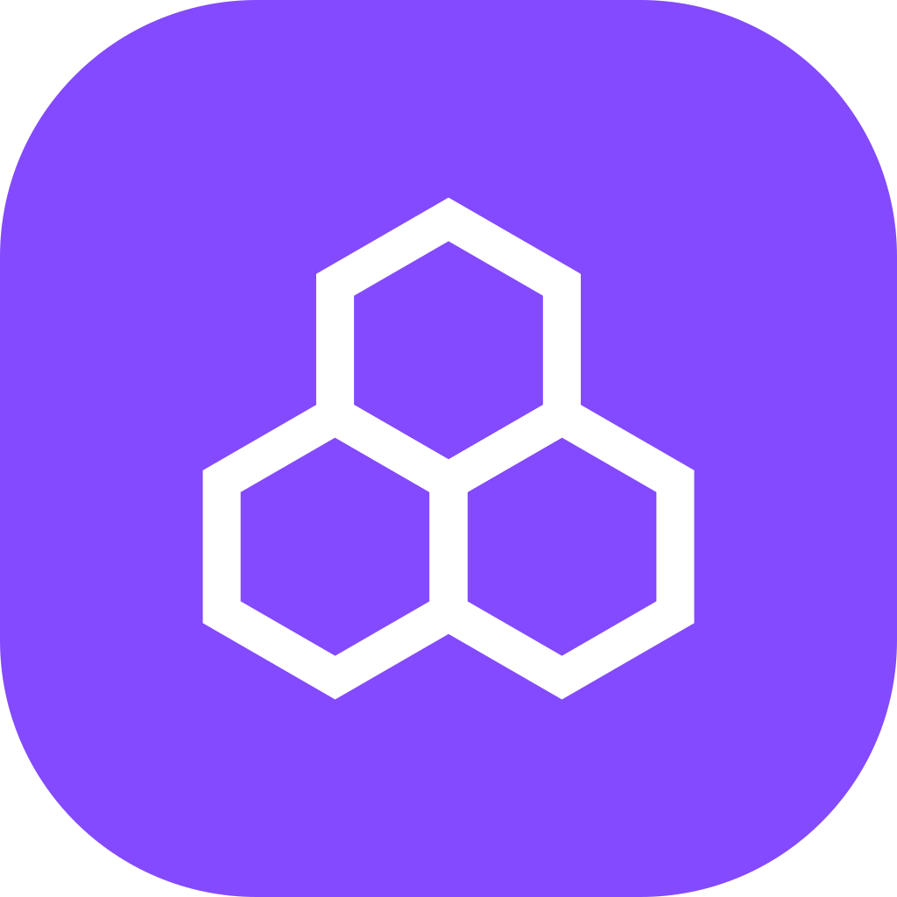
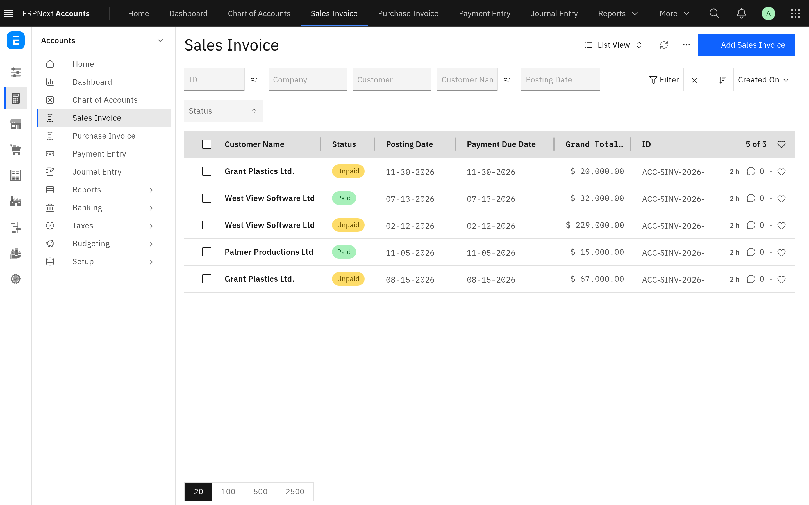

<!-- Copyright (c) 2026, Avunu LLC and contributors
For license information, please see license.txt-->

<!-- frappe-nix:begin header -->

<div align="center">



# Carbon Theme for Frappe

IBM Carbon Design System theme for the Frappe desk, website, login and email

[](https://github.com/Avunu/carbon_theme/actions/workflows/ci.yml)
[](https://github.com/Avunu/carbon_theme/releases)
[](license.txt)
[](https://github.com/frappe/frappe/tree/version-16)

<picture>
  <source media="(prefers-color-scheme: dark)" srcset="docs/screenshots/list-view-dark.webp">
  
</picture>

</div>

<!-- frappe-nix:end header -->

## Overview

Carbon Theme restyles Frappe and ERPNext as if they had been designed with IBM's [Carbon Design System](https://carbondesignsystem.com) (v11): IBM Plex type, square corners, Carbon's colour tokens and 2px focus rings, the Carbon UI Shell header and Carbon's chart palettes. The values come from the official `@carbon/*` npm packages.

It replaces Frappe's own stylesheets rather than adding a layer on top of them, so each surface loads one stylesheet. It is for teams that work in the Frappe desk all day and want a denser, more consistent interface, and for organisations that already use Carbon. It targets Frappe v16 (16.50 or later).

## Features

- **Every surface themed:** the desk, the website and portal, the login page, e-mail, charts, and the frappe-ui apps (CRM, Helpdesk, Builder, Wiki and others). Light mode uses Carbon's g10 theme and dark mode its g100 theme, following the desk's theme setting.
- **Carbon UI Shell header** built from Frappe's module sidebar: the module's links and sub-menus, with an overflow menu, search, notifications, the account menu and an app switcher.
- **One table engine** (TanStack Table, drawn as Carbon's data table) behind child tables, the List view and the Report and Query views. It adds column resizing, reordering and sorting, virtualised report rows, spreadsheet-style selection, copy and paste in the Report view, a Carbon toolbar and pagination on child tables, and child-table rows that expand into their form in place. Frappe's public JavaScript APIs and the old CSS classes keep working.
- **Brand colours** in **Carbon Settings**: separate light and dark brand colours, plus the header's background and text. Hover, active and text-on-brand tones are derived.
- **Dev indicator:** on `localhost` and `*.localhost` sites the header is yellow with hazard stripes, so a development tab is not mistaken for production.
- **Carbon charts:** `frappe.Chart` gets Carbon's 14-colour categorical palettes when the caller passes no colours, and charts re-theme when the desk theme changes.
- **IBM Plex** fonts, self-hosted, with IBM Plex Mono for numbers and dates in tables.
- **AI assistant panel:** when the [flow](https://github.com/frappe/flow_client) app is installed, the header gets a Carbon AI Chat panel that replaces flow's own, with conversation history, feedback and file attachments.
- **Drift audits** (`yarn audit:drift`) that fail when a Carbon token, a Frappe selector or the asset shadow the theme depends on has changed, because those breakages are otherwise silent.

<!-- frappe-nix:begin compatibility -->

## Compatibility

| Frappe | Branch       |
| ------ | ------------ |
| v16    | `version-16` |

<!-- frappe-nix:end compatibility -->

<!-- frappe-nix:begin installation -->

## Installation

On Frappe Cloud, install Carbon Theme for Frappe from the [Frappe marketplace](https://cloud.frappe.io/marketplace/apps/carbon_theme).

On a bench of your own:

```bash
bench get-app https://github.com/Avunu/carbon_theme --branch version-16
bench --site <site> install-app carbon_theme
```

<!-- frappe-nix:end installation -->

Until the first release creates the `version-16` branch, install from `develop` instead: `bench get-app https://github.com/Avunu/carbon_theme --branch develop`.

Then run a full `bench build`. `bench get-app` installs the npm dependencies the stylesheets are compiled from; if the first build stops on a missing import, run `bench setup requirements` and build again. [Deploying](docs/deploying.md) explains how to check that the theme is being served.

## Configuration

The theme works without configuration. Two things can be set:

- **Carbon Settings** (System Manager, in the Carbon Frappe module): **Brand Colour (Light)**, **Brand Colour (Dark)**, **Header Background** and **Header Text**. All are optional, and an empty field keeps Carbon's own value. The brand colour sets Carbon's interactive colour: primary buttons, links, focus rings, selected rows, the sidebar selection bar and the active tab. If only the light colour is set, the dark one is derived from it. A saved change shows on the next page load.
- **The dev indicator** is decided from the request's host name. Turn it off or on for a site with `bench --site <site> set-config carbon_dev_indicator 0` (or `1`). Where the site config does not set it, a `carbon_dev_indicator` cookie does the same for one browser.

[Configuration](docs/configuration.md) describes how the colours are derived and what is deliberately not branded.

## How It Works

- **Stylesheet shadowing.** Frappe looks every stylesheet up in `sites/assets/assets.json` by its bundle name. This app ships bundles with the same names as Frappe's (`desk.bundle.css`, `website.bundle.css`, `login.bundle.css`, `email.bundle.css`) that recompile Frappe's own SCSS with Carbon's values and add Carbon's components on top. Because the app builds after Frappe, its entries replace Frappe's. `scripts/patch-assets.ts` (run by `bench build`) and the `after_migrate` and `after_app_install` hooks (`carbon_theme.build.patch_assets`) point the entries back at the app if a partial build has reset them.
- **Token mapping.** Carbon's design tokens are emitted as `--cds-*` custom properties, and Frappe's colour ramps, neutral roles, radii, focus, shadows and type scale are mapped onto them, so Frappe's own components pick up Carbon's values.
- **Brand stylesheet.** The colours from Carbon Settings are served per site at `/carbon-brand.css` by a `page_renderer` (`carbon_theme/brand.py`) and linked after the bundles through `app_include_css` and `web_include_css`. It is empty until a colour is set or the dev indicator is on.
- **frappe-ui apps.** Apps built with Vite bypass Frappe's asset pipeline, so an `after_request` hook (`carbon_theme/injector.py`) adds `carbon_frappe_ui.bundle.css` and the brand stylesheet to any HTML response that loads a Vite module entry.
- **JavaScript bundles** (`app_include_js`): `carbon_charts` (chart palettes), `carbon_desk` (marks numbers and dates for IBM Plex Mono), `carbon_anatomy` (the UI Shell header, the page header and the assistant's button) and `carbon_tables` (the table engine, which replaces `frappe.ui.form.Grid`, the List view rows and `frappe.DataTable`). Each theme patch calls the original and falls back to Frappe's own behaviour if what it patches is missing.

The documentation covers each part in detail: [How it works](docs/how-it-works.md), [UI Shell header](docs/ui-shell.md), [Tables](docs/tables.md) and [AI assistant](docs/ai-assistant.md).

## Limitations

- **The theme applies to the whole bench.** `assets.json` is shared by every site on a bench, so sites that do not have the app installed are themed too. Run it on a bench of its own.
- **Partial builds and `bench watch` undo the theme.** `bench build --apps frappe` and `bench watch` point the shadowed bundles back at Frappe's until the next full `bench build` or `bench migrate`. Nothing errors; the desk simply looks like stock Frappe again. After a watch session, run `node scripts/patch-assets.ts` in the app's directory.
- **Shadowing depends on undocumented behaviour** of how Frappe names and merges `assets.json` entries. A Frappe change there can stop the theme from loading.
- **No UI Shell header or assistant on phones.** Below 768px wide Frappe's own navbar is kept. It is also kept wherever Frappe fills the header itself: on read-only sites, while impersonating a user and while an announcement widget shows.
- **Column pinning does not work on child tables.** `df.sticky` and the leading gutters do not stay fixed when a child table scrolls sideways; the List and Report views are not affected.
- **Some tables are not replaced:** the Data Import preview and the System Console keep the stock frappe-datatable (still themed), and `frappe.ui.EmbeddedList` keeps its plain table.
- **Older frappe-ui apps are themed on a best-effort basis.** Apps on frappe-ui v0 (and flow's `beta.3`) use older token names, some of which cannot be mapped exactly; CRM's `1.0.0-beta.29` can show some coloured text one shade off.
- **E-mail** is inlined by Premailer, which supports no CSS variables, so e-mail gets Carbon's default colours, not the brand colours. On website pages, Bootstrap utilities such as `.text-primary` also keep the Website Theme's colour.
- **The AI assistant** needs the flow app. It does not tell the model which document is open, and files a user attaches stay on the site as private files until flow's 30-day purge.

<!-- frappe-nix:begin support -->

## Support

- Bug reports and questions: [GitHub issues](https://github.com/Avunu/carbon_theme/issues)
- E-mail: <mail@avu.nu>

<!-- frappe-nix:end support -->

<!-- frappe-nix:begin development -->

## Development

```bash
nix develop        # or: direnv allow
prek install       # the git hooks CI runs
frappe-test        # the tests, the way CI runs them
```

The managed files, checks and release flow are described in the [app standards documentation](https://docs.avunu.net/frappe-nix/docs/app-standards/).

<!-- frappe-nix:end development -->

The build, the checks and the browser test suites, the drift audits, CI and the release process are described in [docs/development.md](docs/development.md).

<!-- frappe-nix:begin license -->

## License

MIT, Copyright (c) 2026–present Avunu LLC → [license.txt](license.txt)

<!-- frappe-nix:end license -->

IBM Plex is included under the SIL Open Font License (see `carbon_theme/public/fonts/LICENSE-*.txt`).
